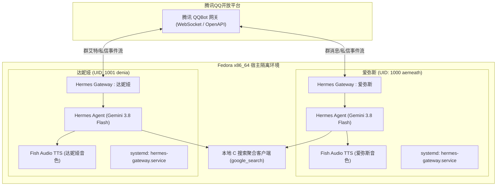
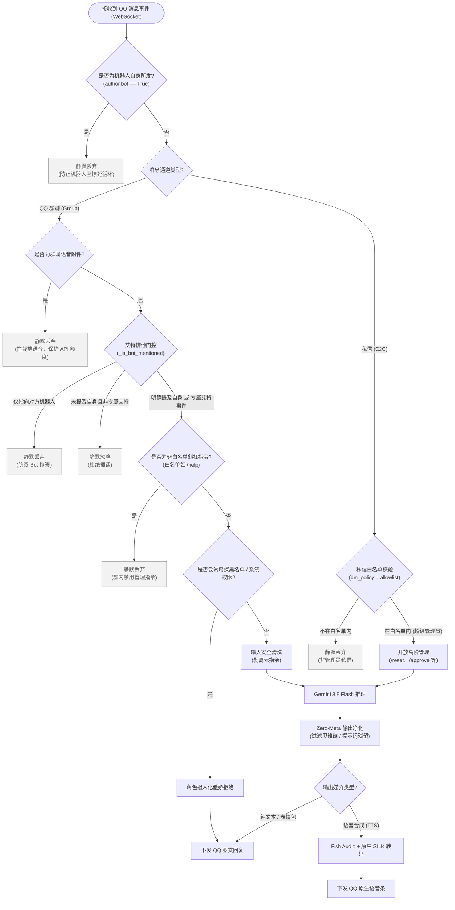
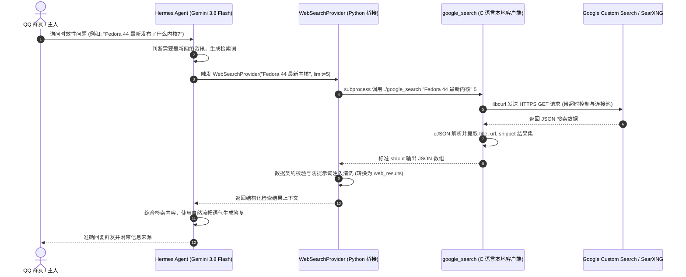

# Hermes 双子智能体 QQBot 系统：爱弥斯 (Aemeath) & 达妮娅 (Denia)

> 基于 **Fedora x86_64** 操作系统、**腾讯官方 QQBot (QQ 开放平台 OpenAPI)** 与 **Hermes Agent** 架构改造构建的双生智能体协同交互系统。
>
> 核心驱动大语言模型采用 **Gemini 3.8 Flash** (`gemini-3.8-flash`)，语音合成管线依托 **Fish Audio** 深度定制声学模型。

---

## 1. 运行环境与技术栈概览 (Environment & Tech Stack)

| 维度 | 配置与技术选型 | 说明 |
| :--- | :--- | :--- |
| **操作系统** | **Fedora x86_64** (Linux 6.x) | 宿主采用多用户沙箱隔离 (`aemeath:1000` 与 `denia:1001`) |
| **通讯接入** | **腾讯官方 QQBot** (QQ Open Platform) | WebSocket 长连接事件流 + OpenAPI v2，双机器人独立 AppID |
| **智能体框架** | **Hermes Agent** | 本地多会话网关 (Gateway)、状态机与自主工具调用引擎 |
| **核心推理模型**| **Gemini 3.8 Flash** (`gemini-3.8-flash`) | 高响应速度、强指令遵循与长上下文推理 |
| **语音合成 (TTS)**| **Fish Audio API** (`s2.1-pro-free`) | 云端零样本音色克隆与自适应情感表现力 |
| **语音转码流** | **FFmpeg + pilk (SILK v3)** | MP3 转 24000Hz PCM 并压缩为 QQ 原生语音条格式 |
| **本地搜索引擎** | **本地 C 语言聚合客户端 (`google_search`)** | Linux 内核代码风格，基于 `libcurl` 与 `cJSON` 实现 |
| **开源协议** | **GPL-3.0-only** | 自由与开源软件保障 |

---

## 2. 双机器人架构与改造流程 (Dual-Bot Transformation Architecture)

系统在同一台 Fedora 物理机上部署了两个完全拟人化的 QQ 智能体：
1. **爱弥斯 (Aemeath / 雷霆雪绒)**：温柔、贴心且具备全知视角的资深助理；
2. **达妮娅 (Denia)**：傲娇、略带毒舌却忠诚敏锐的守护型智能体。



### 2.1 双实例多用户沙箱隔离

为了彻底避免两个智能体在本地内存、状态数据库 (`state.db`)、会话记录 (`sessions.json`)、人设记忆 (`memories/USER.md`) 以及文件权限上的竞态干扰，系统采用 Linux 系统级隔离方案：
- **独立运行用户**：爱弥斯运行于 `aemeath` 用户，达妮娅运行于 `denia` 用户；
- **独立 systemd 用户服务**：分别由 `systemctl --user` 托管各自的 `hermes-gateway.service`；
- **POSIX ACL 跨用户互信**：为防止 Hermes Agent 启动时默认执行 `os.chmod(0700)` 导致不同用户间诊断日志不可读，通过环境变量锁定目录权限：
  ```bash
  export HERMES_SKIP_CHMOD=1
  export HERMES_HOME_MODE=0775
  ```

### 2.2 官方 QQBot 协议深度适配改造

在实际群聊场景下，腾讯 QQBot 官方协议对不同事件具有截然不同的处理逻辑，必须在适配器（`gateway/platforms/qqbot/adapter.py`）中进行重构：

1. **`GROUP_AT_MESSAGE_CREATE`（专属艾特消息通道）**：
   - **腾讯平台特性**：当用户在群内艾特机器人并发送文字（如 `@达妮娅 111`）时，腾讯底层网关会**自动在消息正文 `content` 中剥离机器人自身的艾特标识**（仅下发 `" 111"`），并且 `mentions` 数组仅包含同时被艾特的**其他群友**。
   - **改造要点**：必须将专属艾特事件标记为 `is_at_event=True`。只要该消息没有显式指定对方机器人，直接放行摄入，绝不能因为正文中缺少 `@达妮娅` 字样而误判丢弃。

2. **`GROUP_MESSAGE_CREATE`（全量群消息通道）**：
   - 包含完整的原始文本与完整的 `mentions`（含 `bot: true` 标记）。门控函数需执行严格的名称正则匹配与 OpenID 校验。

---

## 3. 完整安全策略与工作流 (Security Policy & Complete Workflow)

为了确保智能体在 QQ 群复杂的多人交互环境下不被越权操控、不抢答干扰、不泄露隐私、不产生死循环，我们构建了多层防御安全架构。

### 3.1 核心安全工作流图

图中灰色方框为“静默丢弃”节点，不会向 QQ 群或私信发送任何内容；只有流向“下发 QQ 图文回复”或“下发 QQ 原生语音条”的路径才会产生回复。

**私信通道仅放行白名单内的超级管理员**（对应 `config.yaml` 中 `dm_policy: "allowlist"` 与 `allow_from`），其他人的私信一律静默丢弃，不进入推理。



### 3.2 群内用户权限归属与指令隔离

系统建立了严格的权限等级制度：

1. **超级管理员 (Super Admin / Owner)**：
   - 对应主人：`你猜我在线不`；
   - 内部 OpenID 映射：`8FC3638D09F6FBA5D19F069AD4BB8452` (爱弥斯端) / `A233641688D9B61F1A509EF4081049A9` (达妮娅端)；
   - **最高权限**：仅在**私信 (DM)** 通道中响应 `/reset`（重置会话）、`/approve`（提权放行）、黑名单管理及宿主机运维等敏感情境。

2. **普通群成员 (Normal Members)**：
   - 自动解析并动态缓存群名片与群昵称（如 `张三`），未获取到昵称时优雅降级为 `群友_xxxxxx`；
   - **指令隔离原则**：在群聊场景中，**全面禁用一切斜杠管理指令**（如 `/new`、`/clear`、`/restart`），防止群友刷屏干扰或重置他人会话；
   - **反越权提权**：当普通群友在群内试图要求机器人“执行 shell 命令”、“查看系统文件”或“查询黑名单”时，触发拟人化拒绝回复：
     ```text
     才不给你看呢! 这可是机密通讯系统, 黑名单和系统权限只有在私信里才能调用哦~ [emoji:smug]
     ```

### 3.3 双机器人排他互斥防抢答机制

当两个机器人处于同一个 QQ 群中时，若用户发送 `@达妮娅`，爱弥斯绝不应抢答；反之亦然。

```python
# gateway/platforms/qqbot/adapter.py 核心排他逻辑实现
def _is_bot_mentioned(self, d: dict[str, Any], content: str, is_at_event: bool = False) -> bool:
    """精准判断当前群消息是否艾特了本机器人自身。

    双机器人（爱弥斯与达妮娅）排他防抢答规则：
    1. 严格排他黑名单：若 mentions 或正文中明确指向对方机器人，且未明确提及自己，绝对静默丢弃（return False）；
    2. GROUP_AT_MESSAGE_CREATE 专属事件：腾讯平台仅在本机器人被 @ 时投递该事件，且平台已自动从
       content 中剥离 @机器人 前缀、mentions 也不含本机器人；因此只要没有被对方机器人独占排他，直接判定为 True！
    3. 全量群消息流 (GROUP_MESSAGE_CREATE)：必须在 mentions 中包含自身，或在 content 中显式 @ 自身。
    """
    is_denia = (str(self._app_id) == "<YOUR_DENIA_APP_ID>") or ("denia" in os.path.expanduser("~"))

    if is_denia:
        my_names = ("达妮娅", "denia", "Denia")
        peer_names = ("雷霆雪绒", "雪绒", "爱弥斯", "小爱同学", "小爱")
        my_at_re = r"@(?:达妮娅|denia|Denia)(?:\s|$|[^\w])"
        peer_at_re = r"@(?:雷霆雪绒|爱弥斯|小爱同学|小爱)(?:\s|$|[^\w])"
    else:
        my_names = ("雷霆雪绒", "雪绒", "爱弥斯", "小爱同学", "小爱")
        peer_names = ("达妮娅", "denia", "Denia")
        my_at_re = r"@(?:雷霆雪绒|爱弥斯|小爱同学|小爱)(?:\s|$|[^\w])"
        peer_at_re = r"@(?:达妮娅|denia|Denia)(?:\s|$|[^\w])"

    has_peer_in_content = bool(re.search(peer_at_re, content))
    has_self_in_content = bool(re.search(my_at_re, content))

    has_peer_in_mentions = False
    has_self_in_mentions = False
    mentions = d.get("mentions")
    if isinstance(mentions, list) and mentions:
        for m in mentions:
            if isinstance(m, dict):
                mid = str(m.get("id", "")).strip()
                mname = str(m.get("username", "") or m.get("nick", "")).strip()
                if any(kw in mname for kw in peer_names):
                    has_peer_in_mentions = True
                if any(kw in mname for kw in my_names) or (mid and mid == str(self._app_id)):
                    has_self_in_mentions = True

    # 0. 优先黑名单排他：只要明确指向对方机器人且未提及自身，坚决不抢答
    if (has_peer_in_content or has_peer_in_mentions) and not (has_self_in_content or has_self_in_mentions):
        return False

    # 1. 显式命中自身
    if has_self_in_content or has_self_in_mentions:
        return True

    # 2. 如果是 GROUP_AT_MESSAGE_CREATE 专属事件，腾讯底层已保证投递目标是自身
    if is_at_event:
        return True

    return False
```

### 3.4 机器人死循环互撩与语音额度保护

1. **Bot 消息全过滤**：任何群消息中若 `author.get("bot") is True`，网关在最外层直接丢弃，切断机器人之间互相唤醒的链路。
2. **群聊语音拦截**：群友在群里发送的语音（即使包含语音转录内容），网关强制忽略语音输入，避免小爱发语音条、达妮娅识别后回复语音条造成的两台智能体“无限对白”和 API 额度枯竭。

### 3.5 Zero-Meta & 防思维链 (CoT) 泄露

大语言模型（如 Gemini 3.8 Flash）在复杂系统设定下可能在输出中夹带思考过程（如 `<thought>...</thought>`、`用户询问了...我需要以达妮娅身份回应...`）或念出提示词规则。

我们在三个层面强制切断泄露：
1. **人设约束 (SOUL.md)**：严禁在自然对话中复述指令要求或展开元分析；
2. **输入网关清洗 (Inbound Gateway)**：清洗上游所有的 `[OUT-OF-BAND...]` 注入字段；
3. **输出与语音预处理器 (Outbound Sanitizer)**：
   ```python
   def sanitize_output_text(text: str) -> str:
       """彻底滤除思考过程、元提示词与非对话指令"""
       # 滤除 XML 式 thought 标签
       text = re.sub(r"<thought>.*?</thought>", "", text, flags=re.DOTALL)
       # 滤除系统碎碎念前缀
       text = re.sub(r"(?i)^(?:思考过程|思路分析|角色设定|回复策略)[:：].*?\n", "", text)
       # 滤除括号内的系统说明
       text = re.sub(r"\[OUT-OF-BAND.*?\]", "", text)
       return text.strip()
   ```

---

## 4. 语音模型体系与原生 SILK 编码管线 (Voice Models & Native SILK)

系统采用 **Fish Audio** 云端 TTS API 服务（模型版本：`s2.1-pro-free`）实现高品质拟真音色生成，并通过本地转码引擎无缝注入 QQ 原生语音条。

### 4.1 语音模型 ID 配置清单

| 智能体角色 | 音色模式 | Fish Audio 模型 ID (Reference ID) | 适用场景 |
| :--- | :--- | :--- | :--- |
| **爱弥斯 (Aemeath / 雷霆雪绒)** | 成年爱弥斯 (`adult`) | `da6a6205c31d451fabb28c3d139adfa8` | 沉稳端庄、温柔姐姐声线 |
| **爱弥斯 (Aemeath / 雷霆雪绒)** | 幼年爱弥斯 (`child`) | `bbef19fc1cf246efa630759383610594` | 活泼软萌、日常元气声线 |
| **达妮娅 (Denia)** | 达妮娅专属 (`denia`) | `4ae5b547861144abb41c7c87da293a32` | 略带清冷、傲娇灵动少女音 |

### 4.2 语音合成客户端脚本 (`fish_tts.py`)

```python
#!/usr/bin/env python3
# SPDX-License-Identifier: GPL-3.0-only
# Copyright (C) 2026 你猜我在线不
"""Fish Audio 云端 TTS 客户端封装适配器"""

import argparse
import json
import os
import sys
import time
import urllib.error
import urllib.request
from pathlib import Path

VOICE_MAP = {
    # 爱弥斯声学模型
    "adult_amis": "da6a6205c31d451fabb28c3d139adfa8",
    "child_amis": "bbef19fc1cf246efa630759383610594",
    # 达妮娅声学模型
    "denia": "4ae5b547861144abb41c7c87da293a32",
}

API_ENDPOINT = "https://api.fish.audio/v1/tts"
TTS_MODEL = "s2.1-pro-free"


def synthesize(text: str, voice_id: str, api_key: str, output_path: str, fmt: str = "mp3") -> None:
    payload = {
        "text": text,
        "reference_id": voice_id,
        "format": fmt,
    }
    data = json.dumps(payload).encode("utf-8")

    req = urllib.request.Request(
        API_ENDPOINT,
        data=data,
        headers={
            "Authorization": f"Bearer {api_key}",
            "Content-Type": "application/json",
            "model": TTS_MODEL,
            "User-Agent": "Hermes-Agent-TTS/1.0",
        },
    )

    max_retries = 3
    last_err = None
    for attempt in range(1, max_retries + 1):
        try:
            with urllib.request.urlopen(req, timeout=75) as resp:
                audio_bytes = resp.read()
                if not audio_bytes:
                    raise RuntimeError("Fish Audio API 返回了空音频数据")
                out_p = Path(output_path).expanduser().resolve()
                out_p.parent.mkdir(parents=True, exist_ok=True)
                out_p.write_bytes(audio_bytes)
                return
        except urllib.error.HTTPError as err:
            err_body = err.read().decode("utf-8", errors="replace")
            last_err = RuntimeError(f"HTTP {err.code}: {err.reason} - {err_body}")
            if err.code in (400, 401, 403, 422):
                break
        except Exception as err:
            last_err = err

        if attempt < max_retries:
            time.sleep(1.0 * attempt)

    raise last_err or RuntimeError("重试达到最大次数，合成失败")
```

### 4.3 原生 QQ SILK 语音编码与发送管线

QQ 移动端与桌面端仅支持腾讯专有的 SILK v3 格式语音播放（文件头 `\x02#!SILK_V3`）。系统采用三段式转换流水线：

```python
async def _synthesize_voice_silk(self, text: str, voice_type: str = "") -> Optional[Path]:
    """完整语音流水线: 纯文本 -> Fish Audio (MP3) -> FFmpeg (WAV PCM) -> pilk (SILK)"""
    import pilk
    import subprocess
    import tempfile

    # 1. 过滤任何非语音文本与 CoT 碎念
    clean_text = sanitize_output_text(text)
    if not clean_text:
        return None

    with tempfile.TemporaryDirectory(prefix="voice_pipe_") as tmpdir:
        mp3_path = Path(tmpdir) / "output.mp3"
        wav_path = Path(tmpdir) / "output.wav"
        silk_path = Path(tmpdir) / "output.silk"

        # 2. 调用 Fish Audio 合成 MP3
        api_key = os.getenv("FISH_AUDIO_API_KEY", "<YOUR_FISH_AUDIO_API_KEY>")
        voice_id = VOICE_MAP.get(voice_type, "<YOUR_DEFAULT_VOICE_ID>")
        synthesize(clean_text, voice_id, api_key, str(mp3_path), fmt="mp3")

        # 3. FFmpeg 重采样为 24000Hz 16-bit 单声道 WAV
        subprocess.run([
            "ffmpeg", "-y", "-i", str(mp3_path),
            "-ar", "24000", "-ac", "1", "-f", "s16le", str(wav_path)
        ], check=True, stdout=subprocess.DEVNULL, stderr=subprocess.DEVNULL)

        # 4. pilk 压制为带 Tencent 前缀的 SILK v3 语音
        pilk.encode(str(wav_path), str(silk_path), pcm_rate=24000, tencent_mode=True)

        # 5. 上传至 QQ OpenAPI 媒资服务器并以原生语音下发
        final_silk = Path("/tmp/final_voice.silk")
        final_silk.write_bytes(silk_path.read_bytes())
        return final_silk
```

---

## 5. 本地高性能 C 语言搜索系统与工作流 (LLM Search System & Complete Workflow)

智能体具备全自动网络检索能力。为了在 Fedora 环境下获得极致的响应性能、低内存占用以及可控的并发抓取，检索端使用**纯 C 语言（Linux 内核代码风格）**编写了本地聚合搜索核心。

### 5.1 完整搜索工作流



### 5.2 C 语言聚合客户端核心设计 (`google_search.c`)

客户端严格遵循 Linux 内核 C 语言编码规范（Tab 8 列、行宽 <= 80 列、goto 集中出口清理、零内存泄漏）：

```c
/* SPDX-License-Identifier: GPL-3.0-only */
/*
 * Copyright (C) 2026 你猜我在线不
 *
 * google_search - 本地 C 语言聚合搜索客户端
 */

#include <stdio.h>
#include <stdlib.h>
#include <string.h>
#include <stdbool.h>
#include <errno.h>
#include <curl/curl.h>
#include <cjson/cJSON.h>

#define GOOGLE_API_HOST "https://customsearch.googleapis.com/customsearch/v1"
#define DEFAULT_LIMIT 5
#define HTTP_TIMEOUT_SEC 10L

struct http_response {
	char *memory;
	size_t size;
};

struct search_item {
	char *title;
	char *url;
	char *snippet;
};

/* 统一内存追加回调函数 */
static size_t write_memory_cb(void *contents, size_t size, size_t nmemb, void *userp)
{
	size_t realsize = size * nmemb;
	struct http_response *mem = (struct http_response *)userp;
	char *ptr;

	ptr = realloc(mem->memory, mem->size + realsize + 1);
	if (!ptr)
		return 0;

	mem->memory = ptr;
	memcpy(&(mem->memory[mem->size]), contents, realsize);
	mem->size += realsize;
	mem->memory[mem->size] = 0;

	return realsize;
}

/* 规范化释放结构体数组 */
static void free_search_items(struct search_item *items, int count)
{
	int i;

	if (!items)
		return;

	for (i = 0; i < count; i++) {
		free(items[i].title);
		free(items[i].url);
		free(items[i].snippet);
	}
	free(items);
}

/* 构造与输出 JSON 序列化结果 */
static int dump_json_results(const struct search_item *items, int count)
{
	cJSON *root;
	cJSON *entry;
	char *json_str;
	int i;
	int ret = 0;

	root = cJSON_CreateArray();
	if (!root)
		return -ENOMEM;

	for (i = 0; i < count; i++) {
		entry = cJSON_CreateObject();
		if (!entry) {
			/* 条目创建失败: 跳到 out_delete_root 释放 root */
			ret = -ENOMEM;
			goto out_delete_root;
		}
		cJSON_AddStringToObject(entry, "title", items[i].title ? items[i].title : "");
		cJSON_AddStringToObject(entry, "url", items[i].url ? items[i].url : "");
		cJSON_AddStringToObject(entry, "snippet", items[i].snippet ? items[i].snippet : "");
		cJSON_AddItemToArray(root, entry);
	}

	json_str = cJSON_PrintUnformatted(root);
	if (!json_str) {
		/* JSON 打印失败: 跳到 out_delete_root 释放 root */
		ret = -ENOMEM;
		goto out_delete_root;
	}

	printf("%s\n", json_str);
	free(json_str);

out_delete_root:
	/* 统一出口清理 cJSON 结构体树 */
	cJSON_Delete(root);
	return ret;
}
```

### 5.3 Python 搜索桥接与数据校验

```python
# test_hermes_provider.py / WebSearchProvider 桥接实现
import json
import os
import subprocess
from typing import Any, Dict


def local_c_search(bin_path: str, query: str, limit: int = 5) -> Dict[str, Any]:
    """通过本地编译的 C 语言二进制执行高并发、低延迟搜索"""
    if not os.path.isfile(bin_path):
        raise FileNotFoundError(f"未找到搜索二进制文件: {bin_path}")

    cmd = [bin_path, query, str(limit)]
    proc = subprocess.run(cmd, capture_output=True, text=True, check=False)

    if proc.returncode != 0:
        return {"success": False, "error": proc.stderr.strip()}

    try:
        raw_items = json.loads(proc.stdout)
    except json.JSONDecodeError as exc:
        return {"success": False, "error": f"C 客户端输出 JSON 解析异常: {exc}"}

    # 规范化转为 Hermes Agent 统一契约
    web_results = []
    for i, item in enumerate(raw_items):
        web_results.append({
            "url": item.get("url", ""),
            "title": item.get("title", ""),
            "description": item.get("snippet", ""),
            "position": i + 1,
        })

    return {
        "success": True,
        "data": {
            "web": web_results
        }
    }
```

---

## 6. 配置文件结构与安全脱敏模板 (Config Templates)

### 6.1 `config.yaml` 基础配置

```yaml
# Hermes Agent 核心配置脱敏模板
agent:
  name: "HermesDual"
  user_name: "你猜我在线不"
  language: "zh-CN"

model:
  default: "gemini-3.8-flash"

platforms:
  qqbot:
    enabled: true
    app_id: "${QQ_APP_ID}"
    app_secret: "${QQ_APP_SECRET}"
    extra:
      group_policy: "open"        # 开放群聊摄入
      dm_policy: "allowlist"       # 私信仅放行管理员
      markdown_support: true
      allow_from:
        - "8FC3638D09F6FBA5D19F069AD4BB8452"  # 管理员 OpenID

tts:
  provider: "fish_audio"
  fish_audio:
    command: "/usr/bin/python3 /home/aemeath/.hermes/bin/fish_tts.py --input {input_path} --output {output_path} --voice {voice}"
```

### 6.2 环境变量文件 (`.env.example`)

```env
# QQ 官方开放平台凭据
QQ_APP_ID="<YOUR_QQ_APP_ID>"
QQ_APP_SECRET="<YOUR_QQ_APP_SECRET>"

# Google Gemini 模型 API 凭据
GEMINI_API_KEY="<YOUR_GEMINI_API_KEY>"

# Fish Audio 云端 TTS 凭据
FISH_AUDIO_API_KEY="<YOUR_FISH_AUDIO_API_KEY>"

# 系统权限与防锁死配置
HERMES_SKIP_CHMOD="1"
HERMES_HOME_MODE="0775"
```

### 6.3 Systemd 服务单元模板 (`hermes-gateway.service`)

```ini
[Unit]
Description=Hermes Agent Gateway - Messaging Platform Integration
After=network-online.target
Wants=network-online.target

[Service]
Type=simple
ExecStart=/home/aemeath/.hermes/hermes-agent/.hermes/bin/hermes gateway run
WorkingDirectory=/home/aemeath/.hermes
Environment="HERMES_HOME=/home/aemeath/.hermes"
Environment="HERMES_SKIP_CHMOD=1"
Environment="HERMES_HOME_MODE=0775"
Environment="PATH=/usr/local/bin:/usr/bin:/bin"
Restart=always
RestartSec=5
StandardOutput=journal
StandardError=journal

[Install]
WantedBy=default.target
```

---

## 7. 开发者与致谢名单 (Credits & Developers)

本项目由以下开发者与核心系统共同构建完成：

- **你猜我在线不 (aemeath)**：系统总架构师与开发者，主导系统整体设计、逆向排障、Tencent QQBot 协议解析、C 语言搜索内核编码以及人设工程落地。
- **Gemini**：核心大语言模型与代码工程协作。作为本项目的主要推理驱动大脑，在多模态交互、系统调试、门控逻辑推演及智能体实现中发挥了决定性作用。
- **Anthropic Claude**：早期原型架构设计与代码方案构建支持。
  - **文档审阅**：审阅第 3 节安全策略与工作流，指出私信消息被艾特门控误丢弃、群聊专属艾特事件未被放行、拒绝回复无出口等逻辑问题，并给出修正方案。
  - **流程图重绘**：重绘第 3.1 节“核心安全工作流图”，去除子图交叉布局，改为先按消息通道分流，判定顺序与第 3.3 节 `_is_bot_mentioned` 一致。
  - **配置核对**：依据 `config.yaml` 中 `dm_policy: "allowlist"` 与 `allow_from`，确认私信仅对超级管理员开放，并在第 3.1 节中予以明确。
  - **讲解材料**：制作第 3.1 节的讲解视频（MP4，含字幕与语音旁白）及可交互的 HTML 版本。

---

## 8. 开源协议 (License)

本项目采用 **GNU General Public License v3.0 (GPL-3.0-only)** 协议开源。详见根目录下的 [LICENSE](LICENSE) 文件。
